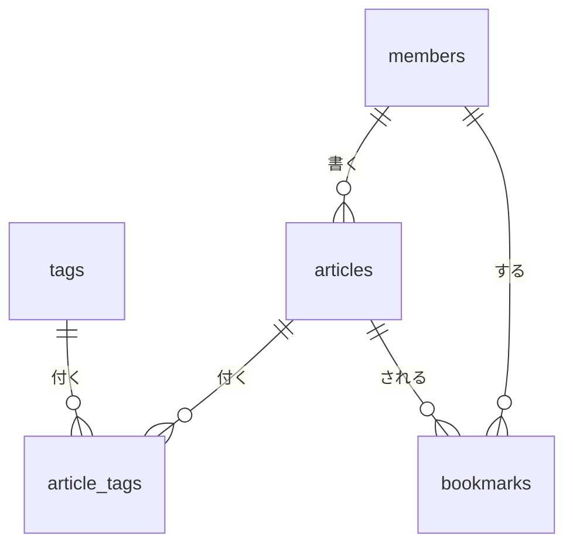

# テーブルと関連の全体像(ERD)

Rails(PostgreSQL)のテーブルが、どうつながるかを1枚で見るためのメモ。

- テーブルと関連(1対多、多対多)だけを描き、カラムは描かない。カラム、型、制約は、各 Issue の仕様書と [architecture.md](../architecture.md) の「データモデル」にある
- 「予定」のテーブルは、まだ決まっていない。名前も関連も、その Issue の仕様書で決まったら、このメモを直す
- テーブルを足したり関連を変えたりした PR では、このメモも直す

## 図

記号の読み方:`||` は「ちょうど1つ」、`o{` は「0個以上」。たとえば `members ||--o{ articles` は、「記事1件には、書いた会員がちょうど1人いる。会員1人は、記事を0件以上持つ」と読む。

## テーブルの一覧

| テーブル | 何を表すか | 状態 |
|---|---|---|
| `members` | 会員。Firebase の uid だけを持つ | 作った(Issue #8) |
| `articles` | 記事。書いた会員を持つ | 作った(Issue #9) |
| `tags` | タグ | 予定(フェーズ3) |
| `article_tags` | 記事とタグをつなぐ | 予定(フェーズ3) |
| `bookmarks` | 会員が記事をブックマークしたこと | 予定(フェーズ3) |

## 図に描いていないこと

- **タグは多対多**:記事1件に複数のタグが付き、タグ1つは複数の記事に付く。多対多は、2つのテーブルを直接つなげないので、間に `article_tags` を置く。同じ記事に同じタグを二重に付けないよう、(`article_id`, `tag_id`)に一意のインデックスを付ける見込み
- **ブックマークも、会員と記事の多対多**:`bookmarks` が間をつなぐ。同じ会員が同じ記事を二重にブックマークしないよう、(`member_id`, `article_id`)に一意のインデックスを付ける見込み
- **サムネイル画像**:Active Storage が、自分のテーブル(`active_storage_blobs`、`active_storage_attachments` など)を作って画像とのつながりを持つ。そのため、`articles` にカラムは足さない見込み(フェーズ3)
- **コメントとリアクション**:PostgreSQL ではなく Firestore に置く([architecture.md](../architecture.md) の「機能一覧」)。Firestore の文書が、PostgreSQL の記事の `id` と、会員の Firebase の uid を持って、記事と会員を指す見込み(フェーズ4)。2つのデータベースをまたぐので、外部キーで守ることはできない
